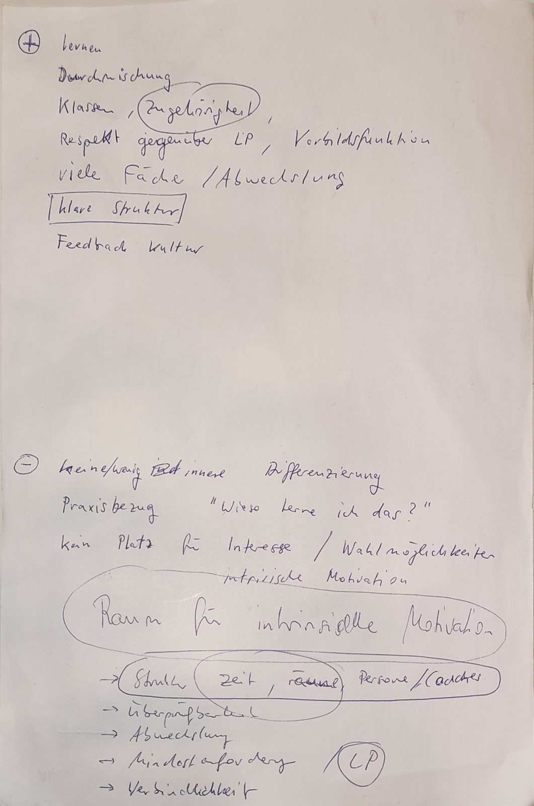
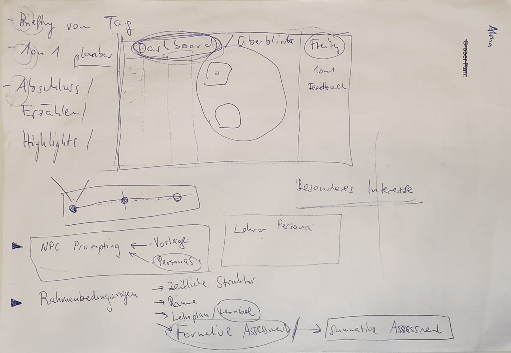
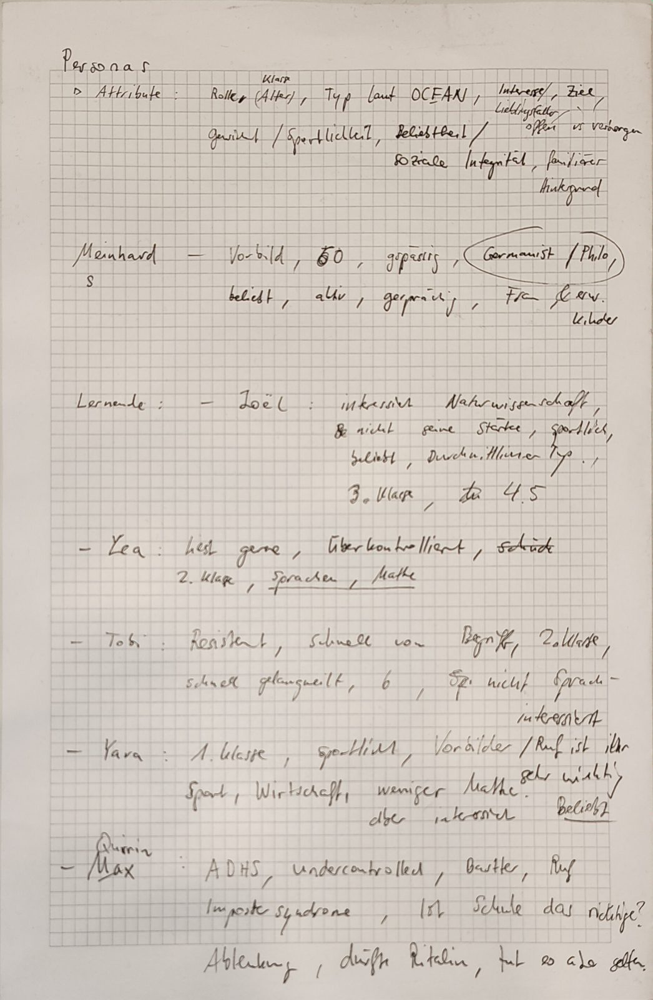
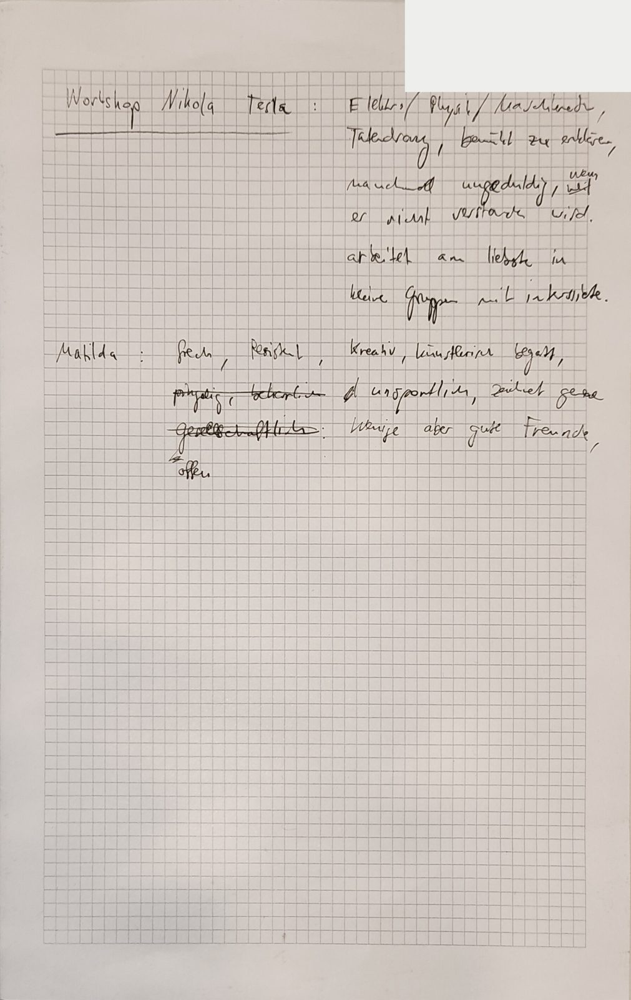

# Schulwelt – Zentral Hack 2026

Challenge «Bring your own challenge by SUVA», Young Talents. Team: Gabriel and
Luca.

Schulwelt is a walkable 3D school you can visit in the browser. You arrive in a
small mountain village, enter the Schulhaus and follow one school morning from
room to room: you plan your own day, watch learners work on binding goals and
on their own projects, talk to an AI coach as yourself and run an experiment in
an optional workshop. The world shows a school model with **room for intrinsic
motivation inside a clear structure**, so pupils, parents and teachers can
experience it instead of reading about it.

## Problem

Many people know school only as lessons in a classroom. Self-directed
learning, coaching and project work are hard to explain; you have to
experience them. Today's school gives structure, belonging and a feedback
culture, but leaves little room for differentiation, practical relevance
(«Wieso lerne ich das?») and learners' own interests.

## Target group

Pupils (in our example Gymnasium years 1–3, about ages 12–15), parents,
teachers and schools that want to explain or discuss a different school model.

## Idea and school model

- **Freedom from the start, inside a clear structure.** Time, rooms and people
  set the frame (fixed points such as Morgenrunde, Mathe-Fixpunkt and
  Abendrunde). Learners plan the free blocks themselves. Freedom is not a
  reward for passing first.
- **Binding minimum requirements.** Teachers derive the goals from the
  curriculum. Everyone has to reach them; the route there is the learner's.
- **Coaching.** Coaches advise and help learners find their own reason to
  learn. They cannot force learning, and agreements are followed up in a
  Friday 1:1.
- **Formative, then summative, under the existing grading regulations.**
  Checkpoints give feedback instead of marks and show risk early; exams and
  grading rules stay as they are.
- **Own projects and interests.** Each learner has a project that answers a
  personal question and serves shared goals (for example a bus timetable
  project as mathematics).
- **Workshops with expert knowledge.** Optional, run by someone whose
  knowledge learners can use in their projects. Working safely is part of it:
  in the lab, learners choose their safety gear before they mix anything.

Details: [docs/idea.md](docs/idea.md),
[docs/shared-concept.md](docs/shared-concept.md),
[docs/pedagogy.md](docs/pedagogy.md). Where the world explains each concept
element: [docs/concept-coverage.md](docs/concept-coverage.md).

## What you experience

| Step | Place | What happens |
| ---- | ----- | ------------ |
| ⓪ | Village square | Joel greets you and points to the Schulhaus |
| – | Entrance hall | Yara at the board: **Tagesplan** station |
| ① | Aula | Morgenrunde with Frau Arnold; Matilda says what she plans today |
| ② | Lernatelier | Lea and Joel prepared with videos and help each other; Quirin's bus project is mathematics |
| ③ | Lernatelier | Mathe-Fixpunkt with Frau Sutter: binding goals, feedback rather than a mark |
| ④ | Interessen-Atelier | Tobi's own project, an audio walk |
| ⑤ | Coaching-Raum | 1:1 with **Herr Meinhard**, the AI coach; **Konflikt** station |
| ⑥ | Workshop-Raum | Optional workshop with Herr Tesla: **Säure-Base-Labor** |
| ⑦ | Aula | Abendrunde (sign): highlights and what stays open |

Each character is a short guided conversation with one quiz question. All
characters and situations are fictional. Route and rooms:
[docs/places.md](docs/places.md).

The four stations:

- **Tagesplan** (`widgets/tagesplan/`): fill the free blocks of a day around
  the fixed points; every choice leads to a room. The «Sicht Coach» tab shows
  fictional learners with a formative status and their next step.
- **Säure-Base-Labor** (`widgets/saeuren-basen/`): pick safety gear, mix
  freely, read the red-cabbage indicator, measure pH, neutralise, solve three
  challenges.
- **Konflikt in der Projektgruppe** (`widgets/konflikt/`): decide for Joel in
  a group conflict across a week; scripted branches with eight endings.
- **Herr Meinhard** (Hazu Genius): an AI coach that knows the school's
  principles ([coach/system-prompt.md](coach/system-prompt.md)). You speak to
  him as yourself.

The day plan and the lab and conflict results are saved as private items on
hazu.app.

### How to open it

- World: https://hazu.app/TRAIMeIVPNXq5wfkfTG2, open without an account.
  Without signing in, results are not saved and Herr Meinhard answers only with
  short offline texts; the AI coach needs a hazu.app account.
- Desktop browser. Use the **fullscreen** button (top right); without it,
  dialogue text and buttons can end up below the visible area.
- WASD or arrow keys walk, **X or Enter** talks and opens doors, **Q/E** turn
  the camera.

## Built during the hackathon vs. existing before

| Part | Status |
| ---- | ------ |
| Hazu platform (hazu.app): content, permissions, hosting, widget bridge | existed before |
| Hazu World engine: 3D world, walking, characters, level builder, Genius integration | existed before |
| Hazu Genius (the AI behind the coach) | existed before |
| Village and Schulhaus levels with rooms and furniture (`level/`) | **new** |
| Characters, guided conversations and quizzes (`level/route-dialogues.mjs`) | **new** |
| Stations: Tagesplan, Säure-Base-Labor, Konflikt; Sägestation and Mathematikvormittag (built, now in reserve) | **new** |
| Coach prompt for Herr Meinhard (`coach/`) | **new** |
| School concept, personas, route and concept coverage (`docs/`) | **new** |
| Engine indoor mode: rooms instead of floating islands, cut-away walls, sliding along walls ([HazuInc/HazuApp#7183](https://github.com/HazuInc/HazuApp/pull/7183)) | **new**; merged by the Hazu team and live on hazu.app since Saturday 12:29. The Schulhaus runs in this mode, so it is a production change of Hazu World |
| Widget bridge fixes in our stations (bridge detection, results saved as private items) | **new** |

This repository holds only what we built during the hackathon, plus docs. No
platform or engine code lives here; the indoor mode is in the engine's own
repository (PR above).

## What came from us, what came from AI

| Part | From |
| ---- | ---- |
| Idea of a walkable 3D world that makes a school model visible and lets people experience it | Gabriel |
| School model: freedom inside a clear structure, fixed points, binding minimum requirements, coaching, own projects, optional workshops, formative before summative | us |
| Personas and their attributes | us |
| Each persona's own project and current difficulty | AI proposals from our attributes, chosen and adjusted by us ([personas](docs/personas.md)) |
| Route through the school morning, which concept element appears where, which characters and stations exist | us |
| Writing up our notes as documents (concept baseline, personas) | AI (ChatGPT, Codex), from our notes |
| Code, levels, furniture, stations, wording of dialogues and docs | AI (Claude Code), on our instructions |
| Checking every result in the browser and deciding what stays | us |

On Friday from about 19:00 to 23:00 we worked on paper only: we wrote down
our thoughts and ideas, drew up the school model and defined the personas
with their attributes. Only after that did we
set up the repository (23:20) and start building. From then on, AI did as
much of the implementation as possible. We gave the goals and the content,
and played and reviewed each step. Details per tool:
[docs/tools.md](docs/tools.md).

Our paper notes from Friday evening (photos; one phone number blacked out):

| Strengths and weaknesses of today's school, our core idea | Rough plan: day structure, dashboard, assessment |
| --- | --- |
|  |  |
| **Personas with their attributes** | **Personas: Herr Tesla and Matilda** |
|  |  |

## Progress timeline

Full log with times: [docs/progress.md](docs/progress.md). Commits in this
repo show the same steps.

- **Friday 23:20–00:40:** repo and Hazu set up; first Bergdorf level with
  houses, doors and characters; Werkstatt interior, checked in the app.
- **Friday night 00:40–03:45:** shared concept baseline; Sägestation; Schulhaus
  with corridor and rooms; engine indoor mode built and opened as a PR;
  age-appropriate personas; Herr Meinhard as Genius coach; Säure-Base and
  Konflikt stations live; first version of the Mathematikvormittag station.
- **Saturday 04:00–08:00:** mathematics station uploaded and expanded to six
  scenes; local text-to-speech trial; bridge bug fixed so stations save on
  hazu.app; focus narrowed to the Schulhaus; lab rebuilt as an open lab.
- **Saturday 08:00–10:00:** morning route ⓪–⑦ with real furniture; Tagesplan
  station; every character turned into a guided conversation covering the
  concept; small Bergdorf around the square.

## Team and roles

| Person | Contribution |
| ------ | ------------ |
| Gabriel | Initial idea of the Schulwelt; school model and personas together with Luca; world and levels, characters and dialogues, stations (Tagesplan, Säure-Base-Labor, Konflikt, Sägestation), wiring into hazu.app, engine indoor-mode PR |
| Luca | Pedagogical perspective on the school model and the personas, shared concept baseline, the mathematics morning (Mathematikvormittag station, branch `codex/mathe`), text-to-speech trial |

The route's Lernatelier scenes reuse the content of Luca's mathematics morning.

## Limits and next steps

- All personas are fictional drafts, not observations of real learners. The
  world illustrates a model; it does not show that the model improves
  motivation or learning.
- The pH model in the lab is simplified for the demo.
- Concept questions still open
  ([shared-concept.md](docs/shared-concept.md#open-decisions)): school type
  and concrete minimum objectives, the exact scope of free choices, coaching
  capacity, how individual contributions in group projects are assessed, and
  the rules for disciplinary measures.
- Not built yet: a week view or timeline with milestones; coach suggestions
  you can click; saving quiz answers given in the world.
- The indoor mode is live, but the Schulhaus still uses its own open-front
  walls; the engine's cut-away walls are not switched on yet.
- The lab's safety rules cite the chemsuisse school guide (2019) and Suva on
  eye protection; no Swiss source covers wafting, so the lab only says to smell
  when the teacher asks ([docs/safety.md](docs/safety.md)).
- Later: other schools describe their own model as a world.

## Repository map

| Folder | Contents |
| ------ | -------- |
| `docs/` | idea, challenge, concept, personas, places and route, safety, progress, tools |
| `level/` | level generators and level files (village, Schulhaus, Werkstatt) |
| `widgets/` | one station per folder; copy `_template/` to start a new one |
| `coach/` | system prompt of the AI coach |
| `skills/` | guides for people and AI helpers: Hazu World, characters, widgets |

What is live where on hazu.app (Hazu IDs, revisions, checksums): [docs/deployment.md](docs/deployment.md).
Open source, third-party components and AI tools: [docs/tools.md](docs/tools.md).
AI helpers and contributors start with [AGENTS.md](AGENTS.md).
